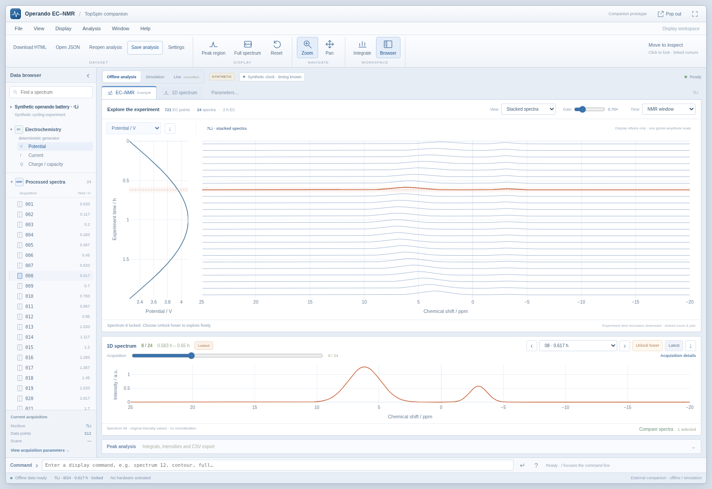

# TopSpin Operando EC–NMR prototype

A working **local** application for completed EC–NMR data and simulated live
acquisition. One Plotly interface supports importing, alignment, linked spectral
selection, stacked or contour NMR views, peak integration, progressive acquisition,
saving and reopening.
The browser, data service and charts run on your computer; no cloud account,
EC-Lab installation or TopSpin installation is needed for these two modes.

**Real hardware acquisition is disabled.** The optional TopSpin launcher is
provided for installation-specific validation. Native GUI embedding, COM/OEM
instrument control and actual instrument synchronization have not been tested.



For a browser-only version and downloadable self-contained HTML, see the
[standalone guide](docs/STANDALONE.md). The Python application below retains raw-file
import and incremental recovery.

## Install and launch on Windows

Install **64-bit Python 3.12** from python.org, including the Python launcher.
Download this branch / release source ZIP, extract it, open PowerShell in that
folder and run:

```powershell
powershell -ExecutionPolicy Bypass -File .\scripts\install_windows.ps1
.\scripts\launch_windows.cmd
```

The execution-policy option applies only to that PowerShell process; it does not
change system policy. The assistant creates `.venv`, installs pinned dependencies
and writes `work/installation-diagnostics.json`. It inspects optional vendor
availability without activating COM, installing vendor software or modifying
TopSpin. An optional, explicitly approved launcher-copy step is documented in
[instrument integration](docs/INSTRUMENT_INTEGRATION.md).

Equivalent manual installation:

```powershell
py -3.12 -m venv .venv
.\.venv\Scripts\python.exe -m pip install -e ".[test]"
.\.venv\Scripts\python.exe -m ecnmr --open
```

Open **http://127.0.0.1:8765** if the browser does not open automatically.
Keep the terminal open; press Ctrl+C there to shut down. A second launch on the
same port requires stopping the first instance. Python 3.10–3.13 is allowed by
our package; verification used Python 3.12 on Linux. Windows installation and
vendor runtime integration still require testing on Windows.

On Linux/macOS:

```sh
python3 -m venv .venv
.venv/bin/python -m pip install -e '.[test]'
.venv/bin/python -m ecnmr --open
```

## Use the viewer

The [TopSpin-style companion shell](docs/COMPANION_UI.md) provides a data browser,
grouped display ribbon, focused-1D tab, working display command line and a
separate pop-out window. It remains an external companion.

The main view places the EC curves and the NMR series side by side on a shared
vertical time axis. Move the mouse through either plot to inspect that time in
both. Click to **pin** the selected acquisition; **Unlock** restores hover
inspection. The dedicated 1D detail shows the selected spectrum for closer
inspection and comparison.

- Switch the NMR series between **stacked spectra** and **contour/map** views.
  Adjust gain for legibility, choose the time coverage, or return to the full
  recorded ppm range. These display controls do not change the imported data.
- The supplied recordings open with the user-requested **same-start assumption**:
  EC and NMR both begin at elapsed time zero. The 64 NMR rows are placed in equal
  estimated intervals across their recorded 74,397-second acquisition extent.
  Timing is immediately usable for exploration, with the assumption shown in the
  interface. It is not recovered per-row timing or validated synchronization.
- A source-only installation opens a clearly labelled synthetic example unless
  experimental paths or a saved session are supplied. Import a completed
  `.mpt`/`.mpr` file or ZIP and a ZIP containing processed Bruker data. The reader
  supports `1r` and explicitly identified pseudo-2D `2rr`; raw FID reprocessing
  and true 2D analysis remain outside this release.
- Open the secondary analysis controls to overlay spectra or track a peak region
  over time, voltage or charge. Integrals use raw signed intensity·ppm; no
  baseline correction or concentration calibration is implied. Alignment and
  instrument settings are available in the collapsed advanced controls.
- In Simulation mode, prepare and start. EC samples and completed NMR spectra
  appear progressively in the same view. Pause/resume, stop, or inject a
  simulated disconnection/failure. Previously arrived spectra remain available
  for inspection. Replaying recordings is still simulation.
- Save a session to retain visible measurements, provenance, timing assumptions
  and analysis settings; reopen the JSON session later. CSV and chart-image
  exports support further analysis and reporting.

To open files directly, including through the TopSpin launcher:

```powershell
.\.venv\Scripts\python.exe -m ecnmr --open --ec "D:\Data\run.mpr" --nmr "D:\NMR\sample\4"
```

The server binds only to loopback. Do not expose it through an external proxy;
it is a local single-user scientific tool. Imports and recovery state are stored
in ignored `.ecnmr/`, or a directory selected with `--state-dir`. Original files
are never modified. There is no automatic deletion of imported copies.

## Important findings in the supplied experimental files

Both archives were extracted and inspected in full; **none of their raw files
are included in Git**. See the detailed [data inspection](docs/DATA_INSPECTION.md).

- Bruker: **64 × 4096 ⁷Li spectra** in a pseudo-2D matrix. The separate procno
  999 is extracted row 51, so it is excluded as a duplicate when loading the
  experiment. Processing SF, byte order, tiling and `2**NC_proc` scaling are
  checked against the actual binary values.
- BioLogic: **98,790 EC points** over about 51.9 hours, from `.mpr`. No `.mpt`
  was supplied. Measured current is absent; the displayed interval-average
  current is derived from `dq/dt` and labelled accordingly. Charge is exported
  signed cumulative mAh, not mass-normalized or per-cycle discharge capacity.
- The EC internal date is in **2024**, while the NMR acquisition is in **July
  2025**. The NMR rows have no individual acquisition timestamps, and automatic
  tune/match can change their cadence. **These files cannot establish a measured
  common timeline.** The requested same-start default and estimated uniform NMR
  intervals enable immediate linked exploration. They are retained as analysis
  assumptions and do not prove the recordings were synchronized.

The repository provides entirely [synthetic example files](examples/README.md)
and a deterministic generator for demonstrations and portable tests.

## Automated verification

```powershell
.\.venv\Scripts\python.exe -m pytest -q
```

Optional real-data checks (extracted original archives kept outside the repo):

```powershell
$env:ECNMR_REAL_DATA = "D:\PrivateData\extracted"
.\.venv\Scripts\python.exe -m pytest -q
```

Optional browser acceptance tests:

```powershell
.\.venv\Scripts\python.exe -m playwright install chromium
$env:ECNMR_BROWSER = "1"
.\.venv\Scripts\python.exe -m pytest tests/test_browser.py -q
```

`ECNMR_CHROMIUM` may point to an existing Chromium executable. See
[verification results](docs/VERIFICATION.md) for actual test runs, screenshots,
limitations and covered acceptance criteria. Direct and optional test dependencies
are pinned in `pyproject.toml`; a full Python-3.12 verification snapshot is in
`requirements-tested-py312.txt`.

## Implementation and integration

The application separates `importers`, `model`, `controller`, `server`, `static`
UI, `adapters`, and `watcher`. Sessions are inspectable JSON. SQLite WAL stores
source snapshots, analysis settings, acquisition progress and timestamped events
incrementally. An interrupted running simulation reopens paused rather than
silently continuing; the operator must explicitly resume it. A downloaded
session includes only measurements visible at the moment it is saved.

The [architecture](docs/ARCHITECTURE.md) and [instrument integration guide](docs/INSTRUMENT_INTEGRATION.md)
explain the verified public vendor capabilities, local TopSpin launcher,
conservative completed-spectrum watcher, and exact hardware validation steps.
The watcher is a separately tested integration building block, not an enabled
hardware acquisition path. It requires an external completion marker.

This source is GPL-3.0-or-later because its MPR reader dependency `galvani` uses
that license. Consult [dependency notices](docs/DEPENDENCIES.md) and `LICENSE`
before redistribution. No proprietary vendor code or eCAT code is included.
